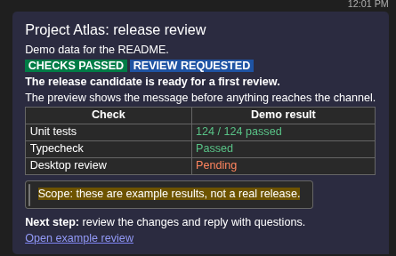
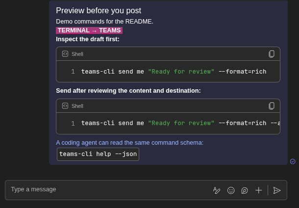
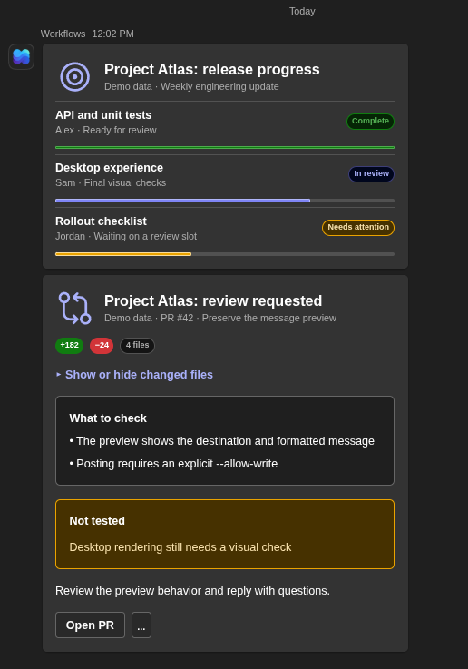
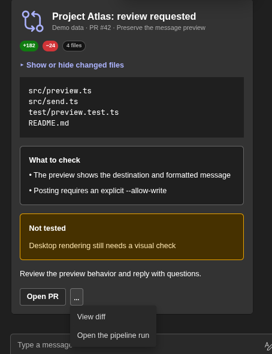

<h1 align="center">agentic-teams-cli</h1>

<p align="center">
  <strong>Microsoft Teams, from your terminal.</strong><br>
  For you and your coding agent. Preview a message before you send it.
</p>

<p align="center">
  <a href="#quick-start">Quick start</a> ·
  <a href="#rich-messages">Rich messages</a> ·
  <a href="#adaptive-cards">Cards</a> ·
  <a href="#updates">Updates</a> ·
  <a href="#command-reference">Commands</a>
</p>

Read a thread, find the context, and turn it into a readable update.
The executable is `teams-cli`. Teams writes preview by default. Posting requires `--allow-write`.

<p align="center">
  
  <br><sub>Sent from the CLI. Rendered in Teams, dark theme. Demo data.</sub>
</p>

```sh
teams-cli history "Engineering/General" --top=10
teams-cli send "Engineering/General" "Ready for review" --format=rich
# Review the preview, then approve the send:
teams-cli send "Engineering/General" "Ready for review" --format=rich --allow-write
```

| Read | Compose | Review | Update |
| --- | --- | --- | --- |
| Chats, channels, threads, search, and unread messages | Colors, badges, tables, code, images, and files | Inspect the destination and message before posting | `teams-cli update` installs a verified release |

> **Before you install:** this independent tool uses internal Teams web endpoints with a dedicated browser session.
> Microsoft changes can break it. Tenant policies and sign-in requirements still apply.
> Work and school accounts are the intended audience. Personal accounts are unverified.

## Install

Download a binary from [GitHub Releases](https://github.com/LegoGuy32109/agentic-teams-cli/releases/latest), or use the installer for your machine.
Running a binary needs no Bun, Node.js, or administrator rights.

### macOS and Linux

```sh
curl -fsSLO https://raw.githubusercontent.com/LegoGuy32109/agentic-teams-cli/main/install.sh
sh install.sh
```

### Windows PowerShell

```powershell
Invoke-WebRequest https://raw.githubusercontent.com/LegoGuy32109/agentic-teams-cli/main/install.ps1 -OutFile install.ps1
powershell -ExecutionPolicy Bypass -File .\install.ps1
```

Each installer downloads the matching release binary and verifies its SHA-256 checksum before installation.
Follow its PATH instructions, then open a new terminal if needed.

<details>
<summary>Platforms, installation folders, and macOS startup</summary>

| Machine | Release asset |
| --- | --- |
| Linux x64 | `teams-cli-linux-x64` |
| macOS Apple silicon | `teams-cli-darwin-arm64` |
| macOS Intel | `teams-cli-darwin-x64` |
| Windows x64 | `teams-cli-windows-x64.exe` |

Linux and macOS install to `~/.local/bin`. Windows installs to `%LOCALAPPDATA%\teams-cli\bin`.
Windows ARM64 may run the x64 build through emulation. Native ARM64 Windows and Linux builds are not supplied.
An unsigned macOS binary may need approval in System Settings, Privacy and Security.
For manual installation, download the matching binary and `SHA256SUMS`, verify the checksum, and place the executable on your PATH.

</details>

## Quick start

```sh
teams-cli auth login
teams-cli auth doctor
teams-cli history me --top=5
```

Sign into your work account in the browser window and complete MFA.
The CLI uses its own Chrome, Chromium, Edge, or Brave profile. It renews stored sessions when possible.
If Microsoft requires another sign-in, run `teams-cli auth login` again.

Start with Notes to self:

```sh
# Preview only:
teams-cli send me "First draft"

# After reviewing the content and destination:
teams-cli send me "First draft" --allow-write
```

Find a destination with `teams-cli conversations`. Use its name or ID in the same commands.

## Rich messages

Use familiar text markup for headings, lists, tables, links, and code.
Add color and badges where they help someone read the result.

```sh
teams-cli send me --format=rich '[badge:green]PASSED[/] Unit tests passed. [orange]Desktop review pending.[/]'
```

<p align="center">
  
  <br><sub>Shell highlighting and inline code in Teams, dark theme. Long lines scroll horizontally.</sub>
</p>

Fenced blocks with a language label become highlighted code blocks.
The [styled message](examples/styled-message.txt) and [code message](examples/code-message.txt) are the sources for the screenshots.
Use `--html @file.html` when you need to supply HTML yourself.

| You want | Use |
| --- | --- |
| A status label | `[badge:green]PASSED[/]` |
| A colored phrase | `[orange]Review pending[/]` |
| A highlighted note | `[hl:yellow]Needs verification[/]` |
| A labeled link | `[Open review](https://example.com/review)` |
| A person mention | `@{Name}`. A real mention can notify that person. |
| An image or file | `--image diagram.png` or `--file report.pdf` |

`--no-preview` keeps links clickable without a page preview card.
For conversation and channel mentions, see `teams-cli send --help`.

## Adaptive Cards

Use a card for a structured update, review, or decision.
Built-in templates include progress, incidents, PR reviews, meeting recaps, polls, and checklists.

<p align="center">
  
  <br><sub>Progress and review cards in the private Workflows chat. Teams, dark theme. Demo data.</sub>
</p>

**Progress:** completion bars and status badges make each workstream visible.
The screenshot uses the built-in `progress` template with [example data](examples/progress.json).


**Review:** put the checks, limitations, and action together.
The [review card](examples/review-card.json) extends the built-in PR review template with an expandable file summary.
Supply your own Adaptive Card JSON when a template needs a different layout.

<details>
<summary>See the expanded review card and supporting links</summary>

<p align="center">
  
  <br><sub>An expandable file summary and supporting links. Teams, dark theme. Demo data.</sub>
</p>

</details>

```sh
teams-cli card templates
teams-cli card example progress > progress.json

# Preview a private card draft:
teams-cli card send me --draft --template progress --data progress.json

# After approval, render it in your private Workflows chat:
teams-cli card send me --draft --template progress --data progress.json --allow-write --wait
```

Cards require a separately configured [Teams Workflow router](docs/cards.md). Ordinary messages do not.
`--draft` sends a real card to your private Workflows chat only when paired with `--allow-write`.
A webhook acceptance response does not prove that Teams displayed the card. `--wait` looks for the posted result.
Client versions, themes, and narrow panes can render elements differently.

See [reproducible examples and screenshot notes](docs/showcase.md).

## For coding agents

The command schema is available without signing in:

```sh
teams-cli help --json
teams-cli send --help
teams-cli help writing
```

Give your agent this instruction:

> Use `teams-cli` to read recent context before drafting a Teams message.
> Preview every write and show me the content and destination.
> Only add `--allow-write` after I approve the send.
> If delivery is uncertain, inspect history before trying again.

Read commands support JSON output. Agents, pipes, and JSON commands do not receive interactive first-run prompts.
A local send-once ledger guards repeated sends. It does not guarantee exactly-once delivery across machines.

## Updates

```sh
teams-cli update --check
teams-cli update
teams-cli version
```

Updates run only when requested. The CLI checks the latest stable GitHub release and verifies `SHA256SUMS` before replacing its executable.
A checksum mismatch stops the replacement. `--check` prints versions as JSON and changes nothing.

<details>
<summary>Update behavior and source builds</summary>

`--json` prints the result as JSON. `--force` permits a downgrade.
Windows schedules replacement after the command exits. Confirm it with `teams-cli version`.
Checksums detect corruption. They do not provide an independent publisher identity check.
Source builds must be rebuilt from their source checkout.

</details>

## Credentials and limits

### Browser sign-in and renewal

Session tokens and browser cookies stay in a local profile. Treat that profile as credentials and never share it.
`teams-cli config path` locates the selected credential file. Never put tokens, captures, or Workflow URLs in issues or source control.
Renewal cannot override Microsoft's interactive sign-in requirements.

### Files

Attach files with `--file report.pdf`. Chat files upload to OneDrive. Channel files upload to the channel's files folder.
The preview shows the destination and sharing plan before uploading anything. Use `teams-cli send --help` for sharing options and limits.

See [scope and limits](docs/limits.md) for region restrictions, delivery uncertainty, and platform verification.

## Command reference

```sh
teams-cli <command> --help
teams-cli help --json
```

<details>
<summary>Expand the full command reference</summary>

<!-- commands:start (generated by `bun run docs` from src/spec.ts; do not edit) -->
| Command | Purpose |
| --- | --- |
| `conversations [--json]` | List teams, channels, and chats with their ids. Uses the csa list, and adds `meeting` and `chat` threads from the chat service that the csa list lacks. Names chats of 8 members or fewer. |
| `history <conversation> [--top=N \| --after-ts=T \| --all] [--system] [--thread ROOTID] [--content] [--json]` | Read messages, oldest first, so the newest is last. Default --top=20, at most 1000. --all reads to the start (capped at 20,000). --system adds calls, recordings, transcripts, and events. --thread ROOTID reads one channel thread. A message with files prints a files: line. Deleted messages are not shown. |
| `history mentions --unread` | Only mentions newer than the read position of their conversation. |
| `context <message-ref> [--before=N] [--after=N] [--json]` | Read a message, the messages around it (default 5 on each side, at most 100), and its channel thread. |
| `search <query> [--in CONVERSATION] [--from PERSON] [--after DATE] [--before DATE] [--on DATE] [--count=N] [--json]` | Search chat and channel messages, as the Messages tab in Teams does. --in takes any conversation form. --from takes an email, or a name that matches one person. DATE is YYYY-MM-DD, a local day. --after DATE keeps messages sent at or after the start of that day. --before DATE keeps messages sent before the start of that day. --on DATE keeps one day. Default 25 hits, at most 1000. A query of filters only is allowed when --from or --in is given. A name for --from that matches nobody or more than one person fails and lists the people. Each hit prints its time, sender, conversation, text, and ref, then markers: [files: names], [image], [mentions you], and `reply in thread <ref>`. Reads pages of 25 and removes duplicate hits. |
| `search --files [<query>] [--in CHANNEL] [--from PERSON] [--after DATE] [--before DATE] [--on DATE] [--type EXT] [--count=N] [--json]` | Search OneDrive and SharePoint files, as the Files tab in Teams does. --in takes a channel and keeps the files in its files folder; Teams has no file scope for a chat. Dates filter the modified time. --type takes an extension such as pdf, or loop or fluid. Each hit prints the name, the folder or site, the modified time and person, and the link. Save a hit with: files download <link>. A query of filters only is allowed when --from or --type is given. |
| `unread [--json] [--refresh]` | List unread chats and channels, with unavailable chats separate. --refresh rechecks access without marking read. |
| `members <conversation> [--json]` | List a conversation's members with name, mail, and role. |
| `users find <query> [--json] [--refresh]` | Find a user ID, display name, or email. A query of 2 or more characters asks the directory. --refresh skips the cache. |
| `emoji find <query> [--json]` | Search the Teams emoji catalog by word, emoji, or key. Works offline. Use a key with react, or :key: in message text. |
| `files download <message-ref\|link> [--out DIR] [--json]` | Save the files and inline images of a message, or one file by its SharePoint link (as search --files prints it), into DIR (default: the current directory). Works for any file you can open in Teams on a *.sharepoint.com site: chat files, channel files, and SharePoint lists (saved as <name>.json). An inline image (history shows it as [image <id>]) is saved as <message-id>-image-<n>.png, .jpg or .gif. Files are mode 0600. A file that exists is never overwritten. Each file can be 250 MB at most, and each image 25 MB. Nothing downloads if any target exists. A file on another organization's SharePoint fails with an error that names it. An image is read from the Teams image host by its id, never from the address in the message. Amer region only for images. |
| `api list \| api <operation> [argument] [--json]` | Inspect or call a verified read operation. Arbitrary URLs and methods are refused. |
| `cache users --refresh` | Clear the user-name cache (no bulk rebuild in Teams). |
| `send <conversation> <text...> [--thread-ts ROOTID] [--format=rich] [--allow-write] [--no-wait] [--json]` | Preview or send a message. --thread-ts ROOTID replies in a channel thread; ROOTID is the root message id or its full ref. --format=rich reads Markdown-style marks: *bold*, _italic_, ~strike~, `code`, # headings, lists, > quotes, tables, links, and fenced code. Pauses at the send limit; --no-wait fails at once instead. Use -- before text that starts with --. Links: [label](https://url). `@{Name}` in the text becomes a mention. A send to `@Name` or an email starts the 1:1 chat when none exists, and only with `--allow-write`. |
| `send ... "[label](https://url)" \| "<https://url\|label>" \| https://url` | Make a clickable link. Write [label](https://url) to show the label, as in Markdown. <https://url\|label> (Slack style) also works. A bare https:// URL becomes a link to itself. All three work in the default format and in --format=rich. The first link gets a preview card by default; --no-preview turns it off. A page that needs a sign-in has no card, and the CLI says so. Only http and https links are made. Put the URL in the parentheses with no spaces. A label in brackets with no URL after it stays text. |
| `send ... --no-preview` | Send the links without a preview card. Each link stays clickable. |
| `send <conversation> --html X\|@file [--allow-write]` | Preview or send HTML. @{Name} in its text becomes a mention (not in tags, attributes, code, or comments). Write @@{ for a literal @{. |
| `send ... "@{Name}" \| "@{everyone}" \| "@{channel}"` | Mention a person (name or email), everyone in a group or meeting chat, or the whole channel. @{everyone} is refused in a 1:1 chat, Notes to self, and a channel. @{channel} is refused outside a channel. To mention a person named Everyone or Channel, write their email. |
| `send <conversation> [text...] --image PATH [--image PATH]...` | Attach up to 10 PNG, JPEG, or GIF images (25 MB each), shown inline. A preview uploads nothing. Amer region only. Not valid with --at. The text comes first, then one picture per paragraph. `history` and `context` show an image as `[image <id>]`. |
| `send <conversation> [text...] --file PATH [--file PATH]...` | Attach up to 10 files (250 MB each). In a chat, a file goes to your OneDrive folder "Microsoft Teams Chat Files", and by default the members open it through the tenant's default sharing link, as Teams does (see --access). In Notes to self only you can open it. In a channel, it goes into the channel's files folder; a name that is there stops the send. A preview uploads nothing and shows the folder and the people. If an upload fails, no message is sent and the files already uploaded are named. Works with --at, --thread-ts, and --image. A send does: pace, send-once check, uploads, invites, message. With `--at`, the files upload and the invites happen now, and the draft carries them. See [Files](#files). |
| `send ... --file X --access=link\|people\|private --role=edit\|view` | Override who can open a chat file for one send. link: the tenant's default link, nobody added by name. people: each member by name, sign-in required. private: only you. Set the default with config file-access and config file-role. |
| `send ... --emoji=plain` | Keep emoji as typed characters. The default writes the Teams emoticon, as the picker does. :key: works in both. |
| `send ... --at TIME` | Schedule the message instead of sending it now. TIME is ISO 8601 with an offset, HH:MM (the next time that clock time comes, so tomorrow if it has passed today), or +<n>m / +<n>h, 1 minute or more ahead. Works with --thread-ts and --file. Not valid with --verify or --image. Not available in Notes to self. |
| `send ... --verify` | Re-read the sent message and compare it. The compare ignores whitespace, so list and line-break markup that Teams stores in another form still matches. |
| `card send <channel> <card.json> [--thread ROOTID] [--draft] [--allow-write] [--wait] [--no-wait] [--json]` | Preview or send an Adaptive Card to a channel, as you, through the Workflows "teams-cli card router" flow. <card.json> holds an AdaptiveCard (type, version, and a body array) or a {type: "message", attachments: [...]} payload with one card. An Image url or backgroundImage of file:<path> (relative to the card file) is replaced by a PNG, JPEG, or GIF data URI before the send. SVG is refused. The payload can be 256 KB at most. --thread ROOTID replies in a channel thread; ROOTID is the root message id or its full ref. The preview sends nothing. It shows the target, the card version and size, an outline, and each image. The flow URL is the environment variable TEAMS_CARD_ROUTER, or the URL that card setup stored in the profile. It is a secret, and the CLI never prints it. Only an https URL on a host that ends in .powerplatform.com or .logic.azure.com is accepted. Cards do not use Teams image upload (AMS): an AMS image can be read only by the conversation it was uploaded for, so channel members may not see it. A data URI is part of the card, so everyone who sees the card sees the image. |
| `card send <channel> --template NAME --data FILE.json [--thread ROOTID] [--draft] [--allow-write] [--no-react]` | Build the card from a built-in template instead of a card file. --data is a JSON file with the template's fields. The CLI checks the data, names the field that is wrong, and builds the card. A card can be 28 KB at most, because Teams refuses a larger one; the epic template cuts hidden issues to fit, and the others fail with the size. <card.json> and --template cannot be used together. The preview adds the template name to the outline. List the templates with card templates, and print the data of one with card example NAME. The templates are meeting-recap, deadline, epic, pr-review, decision, poll, progress, incident, standup, and qa-checklist. See docs/cards.md. |
| `card send ... --template decision\|poll --allow-write [--no-react]` | A template that asks for a vote (decision, poll) adds each option emoji as your own reaction after the post, so people can click it. The CLI first waits up to 20 s for the new message, as --wait does, then reacts through the same path as react, with the same pacing. The preview lists the reactions. --no-react skips them. If the message is not found, the CLI says so and prints the react commands to run by hand. An emoji that has no Teams reaction key fails in the preview, before anything is sent. Count the votes with card votes REF. A reaction you already have is not added twice. The send-once ledger stops a repeated send, so it stops repeated reactions too. A reaction has no ledger record of its own. |
| `card send ... --wait` | After the 202 answer, read the target conversation (read only) for up to 20 s. Find your newest message, or the Workflows bot's for a draft, that has a card with the same card hash. Print its ref, so card update can use it. The ref is also kept in the ledger record. Without --wait, the command prints how to find the ref. |
| `card send <channel> <card.json> --draft --allow-write` | Send the card to your private Workflows chat instead, so you see the real rendering. Do this first. The card goes there whatever the channel, and a chat is accepted as <channel>. A draft and the final post of the same card are separate sends. |
| `card send <channel> <card.json> [--thread ROOTID] --allow-write` | Post the card in the channel as a new post, or as a reply when --thread is given. Every send passes the send-once ledger. Only a 202 answer counts as accepted, and it means the flow took the card, not that Teams posted it. The flow refuses a channel that is not on its allowlist, and it does this after the 202. A network error, a 408, or a 5xx is an unknown outcome and is never retried. |
| `card update <ref> --template NAME --data FILE.json [--allow-write]` | Update a posted card from a template and its data, as card send --template builds it. The incident template is made for this: send it once, then update it with the same ref as the timeline grows. <ref> and the card file rules are the same as below. <card.json> and --template cannot be used together. |
| `card update <ref> <card.json> [--allow-write] [--no-wait] [--json]` | Preview or make an edit of a card that was posted through the card router. <ref> is <channel>#<id> for a channel post, <channel>;messageid=<root>#<reply> for a thread reply, or draft#<id> (or a ref in your Workflows chat) for a draft. card send --wait prints the ref. The preview says what would change and makes no request. Every update passes the send-once ledger, keyed by the target and the card hash. Only a 202 answer counts as accepted. Router mode `update` takes `channel` and `messageId`. For a reply, `messageId` is <root>/replies/<reply>, exactly; the bare reply id gives 404. A draft uses mode `update-draft` with `messageId`, in your Workflows chat. The channel must be on the flow's allowlist, and the flow refuses it after the 202. |
| `card templates [--json]` | List the built-in card templates. Each has a one-line purpose and its data fields. Offline. |
| `card example <template>` | Print example data for a template as JSON. Save it, change it, and pass it to card send --template NAME --data FILE. The examples use made-up names. Offline. |
| `card votes <ref> [--json]` | Count the votes on a decision or poll card: the reactions of other people under each option emoji. It reads the message and writes nothing. Your own reactions are left out, because card send added them as the seed. <ref> is <conversation>#<id>, <channel>;messageid=<root>#<reply>, or draft#<id>. The templates mark each option with an id, and the CLI reads the options from the card in the message. A message without that mark lists every reaction. Reactions that are not an option are listed apart. A skin-tone variant of an option emoji counts for the option. |
| `card setup [--channel CHANNEL]... [--allow-write] [--json]` | Preview or create the "teams-cli card router" flow for you from the template that ships with the CLI. --channel adds a channel to the flow's allowlist and can repeat. An existing router is updated, and its allowlist is kept and added to. The preview writes nothing. It shows the environment, the connection, the modes, the allowlist, and whether a router exists. With --allow-write, the CLI creates or updates the flow and keeps its webhook URL in your profile (mode 0600). It never prints the URL. The Flow API needs a token. Set TEAMS_FLOW_TOKEN (audience https://service.flow.microsoft.com/) and TEAMS_POWERAPPS_TOKEN (audience https://service.powerapps.com/), or sign in with the Azure CLI to the same tenant as your Teams profile (az login). The flow uses your first connected Teams connection. If you have none, open Workflows in Teams once. The update-draft mode needs your Workflows chat, and is left out when the chat does not exist yet. |
| `scheduled [--json]` | List your scheduled messages with their draft ids, send times, and files. |
| `scheduled cancel <draft-id> [--json] [--allow-write] [--no-wait]` | Preview or cancel one scheduled message. Files it carries stay on SharePoint. An id that is not in the live list is refused. |
| `edit <conversation> <message-id-or-ref> <text...> [--format=rich] [--html X] [--emoji=plain] [--no-preview] [--json] [--allow-write] [--no-wait]` | Preview or replace your own message's text. Links work as in send. |
| `delete <conversation> <message-id-or-ref>... [--thread-ts ROOTID] [--json] [--allow-write] [--no-wait]` | Preview or soft-delete your own messages. Deleting a message leaves its files on SharePoint. Run "files delete <ref>" first. |
| `files delete <message-ref> [--json] [--allow-write] [--no-wait]` | Preview, or move to the SharePoint recycle bin, the files of one message that you uploaded. The preview lists each file, its size, and its uploader. A file of another person is refused. A file that is gone is reported as already gone. The Teams message is not changed. Run this before "delete", because a deleted message no longer lists its files. It acts only on `*.sharepoint.com` files whose `Author` email matches your UPN. A SharePoint list is refused. It never hard-deletes, and it prints each recycle bin item id. |
| `react <conversation> <message-id-or-ref> <emoji> [--verify] [--json] [--allow-write] [--no-wait]` | Add your reaction. <emoji> is any emoji (❤️, 🚀, 👍🏽), a catalog key (heart, launch, yes-tone3), or a raw key. Catalog keys are Teams names: 👍 is yes and 🚀 is launch. Says so if you already used it. |
| `unreact <conversation> <message-id-or-ref> <emoji> [--verify] [--json] [--allow-write] [--no-wait]` | Remove your reaction. Says so if you did not use it. |
| `mark <conversation> [--json] [--allow-write] [--no-wait]` | Mark a conversation read up to its newest message. |
| `mark --all-unread [--json] [--allow-write] [--no-wait]` | Mark every conversation that "unread" lists. |
| `ledger list [--json]` | List send records. |
| `ledger clear <key>` | Remove one send record. |
| `auth login [--browser PATH]` | Start here. Sign in once in a visible browser (Chrome, Edge, Brave, or Chromium) with its own profile. After that, tokens renew by themselves, headless. Complete MFA and choose "Stay signed in". On a first run at a terminal, any command that needs tokens offers this sign-in. Agents, pipes, and `--json` are never asked. See [Browser sign-in and renewal](#browser-sign-in-and-renewal). |
| `auth status` | Show each token's expiry, the browser profile, and test the connection. |
| `auth renew [--browser PATH]` | Renew now from the browser profile, headless, with no prompt. |
| `auth doctor [--browser PATH] [--json]` | Check this machine: version, platform, browser, profiles, tokens, SharePoint host, region, and clock. One line per check with ok, warn, or fail, and the fix. Exit code 1 if any check fails. Writes nothing and starts no browser. `--json` prints `{checks:[{name,status,detail,fix}]}`. Token values are never printed. The clock check sends one unauthenticated request to the Teams host and is skipped when offline. |
| `auth < pasted-curl.txt` | Fallback without a browser: save tokens from cURL commands copied from the browser's network tab. |
| `auth setup-refresh < token-request.txt` | Import a captured OAuth refresh request. |
| `auth refresh` | Renew stored service tokens now. |
| `logout` | Remove a profile. |
| `config path` | Print the credentials file path. |
| `config file-access [link\|people\|private\|default]` | Show or set who can open a file sent to a chat. Default link. |
| `config file-role [edit\|view\|default]` | Show or set what members can do with a chat file. Default edit. |
| `config skin-tone [light\|medium-light\|medium\|medium-dark\|dark\|none]` | Show or set the skin tone for emoji that take one. |
| `update [--check] [--force] [--json]` | Check or install a public GitHub release. --check prints versions as JSON and writes nothing. --force permits a downgrade. --json prints the result as JSON. Downloads verify SHA256SUMS before replacement. Work-portal builds remain managed by apps/wp build teams-cli. |
| `version \| --version` | Print the installed version. |
| `help [command] [--json] \| <command> --help [--json]` | Show this summary, or one command's help. help writing shows advice for messages that need a reply. --json prints the command list for programs. |
<!-- commands:end -->

</details>

## Build and contribute

```sh
bun install --frozen-lockfile
bun run typecheck
bun test
bun run build
./dist/teams-cli --help
```

Tests use fake tokens and services. They need no tenant credentials.
This repository receives maintained exports from the upstream CLI.
Read [maintenance](docs/maintenance.md) before changing generated files, and use synthetic data in bug reports.
